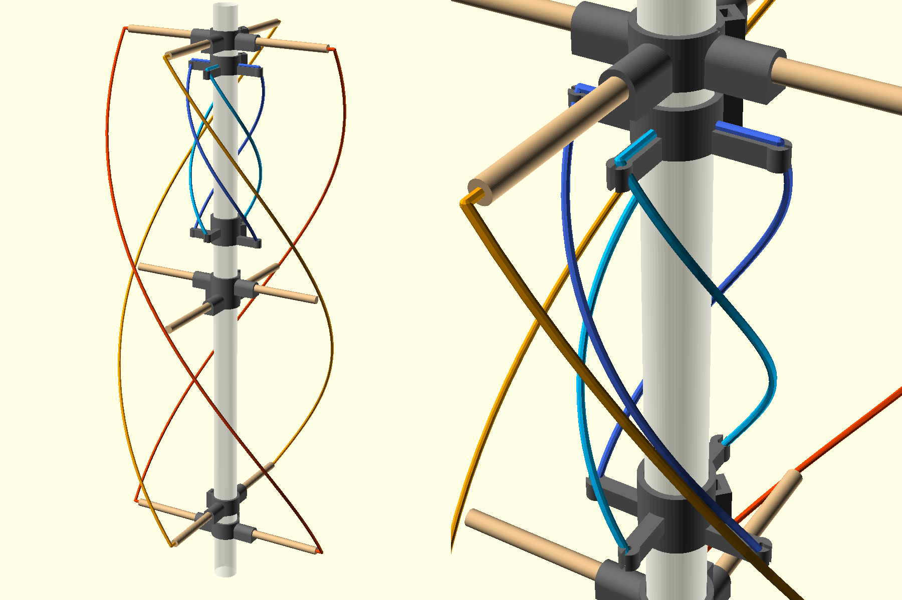
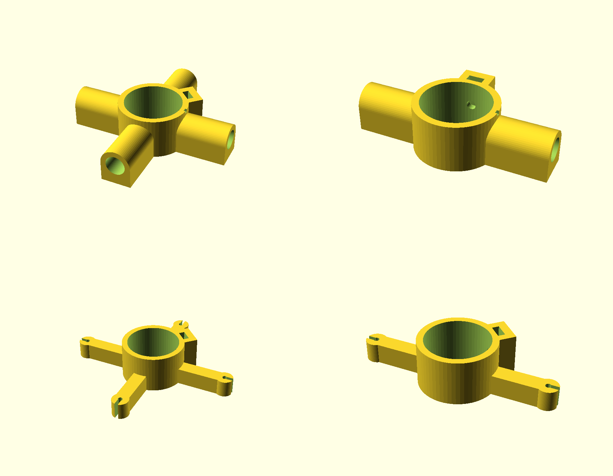

# QFH doble banda 2 m / 70 cm – versión imprimible

Antena **QFH** (*Quadrifilar Helix*, hélice cuadrifilar) para las bandas de radioaficionado de
**2 metros (VHF)** y **70 centímetros (UHF)**, con una sola bajada de coaxial y sin duplexor.
Está basada en el diseño de **EA1PA** publicado en
[EA5WA – QFH Dual Band EA1PA](https://www.ea5wa.com/antenas/qfh-dual-band-ea1pa).

Esta versión se construye con materiales baratos y piezas impresas en 3D:

- Tubo central de 30 mm (PVC).
- Hilo de cobre de 2,5 mm, sacado de un cable de tierra desnudo de 35 mm² destrenzado.
- Varilla de cortina (o de madera) de 10 mm como brazos de la parte de VHF.
- Crucetas, puntas aisladoras y grapas impresas en 3D.



---

## Las bandas

| Banda | Rango (IARU Región 1) | Frecuencia de diseño | Longitud de onda |
|---|---|---|---|
| 2 m (VHF) | 144 – 146 MHz | 145,700 MHz | 2,06 m |
| 70 cm (UHF) | 430 – 440 MHz | 435,300 MHz | 0,69 m |

Las frecuencias de diseño están en la zona de satélites de cada banda: 145,8 – 146 MHz en 2 m y
435 – 438 MHz en 70 cm. Es el uso típico de una QFH: **escuchar y trabajar satélites de
radioaficionado y la ISS**. También sirve como antena de base omnidireccional para uso general.

---

## Cómo funciona una QFH

Una QFH está formada por **dos espiras rectangulares (bucles)** retorcidas media vuelta alrededor
de un eje vertical. Quedan cruzadas a 90° y dan cuatro hélices, de ahí el nombre de *cuadrifilar*.

- **Espira grande y espira pequeña:** una es algo más larga que una longitud de onda y la otra
  algo más corta. La grande se comporta como inductiva y la pequeña como capacitiva, así que sus
  corrientes quedan desfasadas unos **90°**. Por eso no hace falta una línea de desfase ni un
  divisor externo.
- **Polarización circular:** gracias a ese desfase, la antena radia con polarización circular. Es
  la que usan los satélites, y evita los desvanecimientos que aparecen cuando el satélite gira y
  la antena es lineal.
- **Sentido de giro:** el sentido de las hélices, junto con qué espira se conecta al vivo del
  coaxial, decide si la polarización es a derechas (RHCP) o a izquierdas (LHCP). Todas las espiras
  deben girar en el mismo sentido. Para satélites se busca RHCP; sigue el sentido del diseño de
  EA1PA.
- **Diagrama de radiación:** es casi hemisférico hacia arriba. Tiene buena ganancia desde el cenit
  hasta horizontes bajos y no hay que orientarla, así que no necesita rotor para seguir satélites.
- **Alimentación:** se alimenta por arriba, en el centro, uniendo los extremos cortados de las dos
  espiras al coaxial.

### Doble banda con una sola alimentación

En este diseño hay **dos QFH, una dentro de otra**, sobre el mismo tubo:

- **Exterior (VHF, 2 m):** dos espiras grandes, sujetas con varillas.
- **Interior (UHF, 70 cm):** dos espiras unas tres veces más pequeñas, con los brazos impresos.

Las dos se alimentan en el mismo punto con un único coaxial. En su diseño, EA1PA comprobó que cada
QFH trabaja en su banda **sin necesidad de duplexor**. Midió una ROE mínima de 1:1,2 en VHF y
1:1,0 en UHF. El choke se hace enrollando el propio coaxial alrededor del mástil.

---

## Dimensiones (centro del hilo)

Relación ancho/alto 0,44.

| Espira | Longitud total | Alto | Diámetro | Radio |
|---|---|---|---|---|
| VHF grande | 2152 mm | 650 mm | 286 mm | 143 mm |
| VHF pequeña | 2037 mm | 615 mm | 271 mm | 135,5 mm |
| UHF grande | 720 mm | 218 mm | 96 mm | 48 mm |
| UHF pequeña | 682 mm | 206 mm | 91 mm | 45,5 mm |

Son **valores de partida**. EA1PA tuvo que reducir el radio unos 10 mm en VHF y unos 5 mm en UHF
para centrar la resonancia. Por eso:

- Las puntas de VHF se deslizan por la varilla y permiten reducir el radio hasta 10 mm sin
  reimprimir.
- Las piezas de UHF ya vienen con 2,5 mm menos de radio (45,5 / 43 mm). Se cambia en
  `qfh_piezas.scad`.

---

## Archivos

| Archivo | Cantidad | Descripción |
|---|---|---|
| `cruceta_vhf.stl` | 1 | Cruceta superior VHF, 4 brazos de varilla |
| `barra_vhf.stl` | 4 | Soportes VHF: 2 abajo y 2 a media altura |
| `punta.stl` | 12 | Aislador en el extremo de cada varilla, con pinza para el hilo |
| `grapa.stl` | 8 | Separa el hilo horizontal 12 mm de la varilla |
| `cruceta_uhf.stl` | 1 | Cruceta superior UHF, con los brazos impresos |
| `barra_uhf_grande.stl` | 1 | Soporte inferior de la espira UHF grande |
| `barra_uhf_peq.stl` | 1 | Soporte inferior de la espira UHF pequeña |
| `qfh_piezas.scad` | – | Modelo paramétrico en OpenSCAD: tubo, varilla, hilo, holguras y radios UHF |
| `vista_montaje.scad` | – | Vista 3D del conjunto montado |
| `MONTAJE.md` | – | Guía de montaje: cortes de varilla, alturas y giros de cada soporte |
| `plantilla_taladros.py` | – | Genera la plantilla de papel para taladrar el tubo (`python plantilla_taladros.py`) |
| `plantilla_taladros.pdf` | – | Plantilla de taladros, 3 hojas A4 para imprimir al 100 % (la crea el script) |
| `plantilla_taladros.svg`, `plantilla_taladros_p1.svg` … `_p3.svg` | – | Tira completa 1:1 y una hoja A4 por SVG (los crea el script) |
| `test_plantilla.py` | – | Autocomprobación de la plantilla (`python test_plantilla.py`) |



### Impresión

- Material **PETG o ASA**. El PLA se deforma y se degrada al sol.
- 4 perímetros y un 40 % de relleno.
- Las piezas están orientadas para imprimirse sin soportes.

### Tornillería y materiales

- 8 tornillos M4 × 16 con tuerca, para fijar los soportes al tubo. La tuerca queda cautiva en la
  pieza.
- 12 tornillos M3 × 8, para fijar cada varilla en su punta.
- 12 trozos de varilla de 10 mm: 6 de 108 mm (espira grande) y 6 de 100 mm (espira pequeña).
- Unos 5,5 m de hilo de cobre de 2,5 mm.
- Coaxial de 50 Ω (RG-58 o mejor) y un conector.

### Plantilla de papel para taladrar el tubo

Ejecuta `python plantilla_taladros.py` (solo Python 3): escribe en la raíz del repositorio
`plantilla_taladros.pdf` y los SVG. Imprime **al 100 %** (sin ajustar a página) y comprueba que el
cuadrado de cada hoja mide 50 mm. Recorta, une las hojas, enrolla la tira alrededor del tubo con la
línea 0° alineada con los brazos del primer soporte, pega con cinta, marca con granete y taladra
(M4: 4,3 mm; entrada de hilos: 4 mm). Detalle en [MONTAJE.md](MONTAJE.md).

### Regenerar las piezas

Si cambias algún parámetro en `qfh_piezas.scad`, vuelve a exportar las piezas con:

```sh
for p in cruceta_vhf barra_vhf punta grapa cruceta_uhf barra_uhf_grande barra_uhf_peq; do
  openscad -o $p.stl -D "PIEZA=\"$p\"" qfh_piezas.scad
done
```

---

## Ajuste

1. Monta primero **solo la parte de VHF** y mide la ROE con un analizador (por ejemplo un
   NanoVNA).
2. Si la resonancia cae baja, reduce el radio deslizando las puntas hacia dentro. Si cae alta,
   hazlo hacia fuera.
3. Añade la parte de UHF y comprueba las dos bandas.
4. Sella las soldaduras del punto de alimentación con silicona.

> Si las varillas de cortina son metálicas, el cobre no debe tocarlas nunca. Usa siempre las
> puntas y las grapas. Una varilla de madera o de fibra de 10 mm afecta menos a la antena.

## Estado

**Diseño sin probar todavía.** Imprime primero una punta y la cruceta de VHF para comprobar los
ajustes con tu tubo, tu varilla y tu hilo. Cualquier mejora o medida real es bienvenida en los
*issues*.

## Créditos y licencia

- Diseño eléctrico original: **EA1PA**, publicado en [ea5wa.com](https://www.ea5wa.com/antenas/qfh-dual-band-ea1pa).
- Piezas imprimibles y documentación de este repositorio: licencia
  [CC BY-SA 4.0](https://creativecommons.org/licenses/by-sa/4.0/deed.es).
